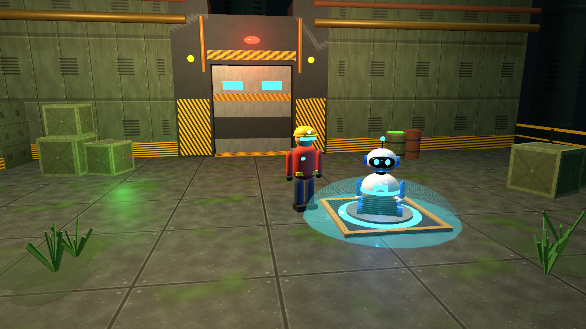
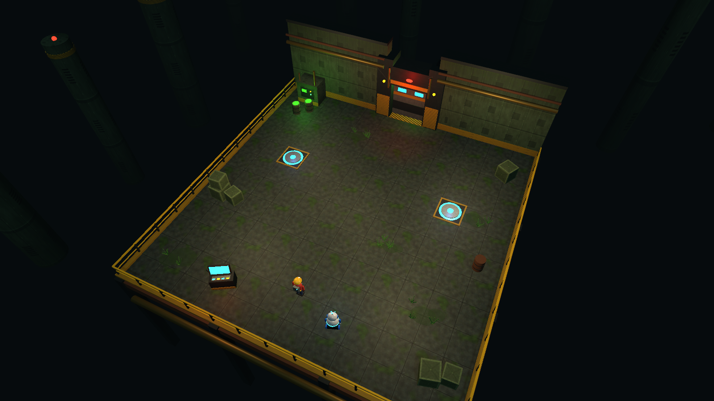
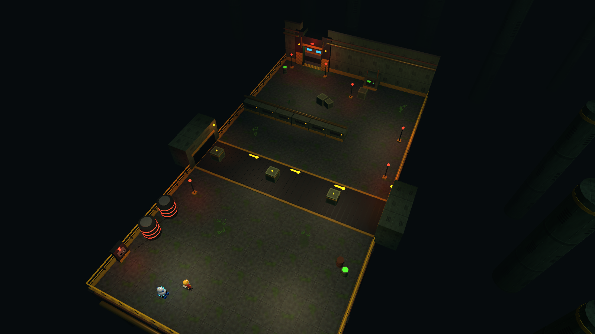

# EchoBot : votre robot se souvient

Jeu de puzzle 3D réalisé avec **Unity 2022.3.62f3**.
Vous êtes un technicien piégé dans une usine robotique abandonnée. EchoBot, votre petit robot,
**enregistre vos mouvements et les rejoue** pendant que vous faites autre chose.

## Ouvrir le projet

1. Ouvrez **Unity Hub**, cliquez sur **Add > Add project from disk**, puis choisissez le dossier `Desktop/EchoBot`.
2. Ouvrez le projet avec la version **2022.3.62f3**.
3. Dans la fenêtre Project, ouvrez `Assets/Scenes/MainMenu.unity`, puis appuyez sur **Play**.

> Les scènes sont générées par le script `Assets/Editor/EchoBotSceneBuilder.cs`.
> Le menu **EchoBot > Reconstruire toutes les scènes** les régénère, et
> **EchoBot > Capturer des images des scènes** refait les images du dossier `Screenshots/`.

## Commandes

| Touche | Action |
|---|---|
| ZQSD / WASD / flèches | Se déplacer |
| Clic droit + souris | Tourner la caméra |
| Molette | Zoom |
| E | Utiliser une console ou un levier |
| R | Démarrer l'enregistrement |
| F | Arrêter l'enregistrement |
| G | EchoBot rejoue la séquence |
| Échap | Pause |

Les boutons **Enregistrer / Stop / Rejouer** en bas de l'écran font la même chose.

## Les niveaux

### Niveau 1 : La salle de sécurité (facile)

1. Activez la console d'enregistrement (lumière orange) avec **E**.
2. Appuyez sur **R**, marchez jusqu'à une plaque bleue, puis appuyez sur **F**.
3. Appuyez sur **G** : EchoBot refait votre trajet et maintient la plaque.
4. Placez-vous sur l'autre plaque et activez le terminal de sécurité avec **E**.
5. Dès que vous quittez la plaque, vous avez **6 secondes** pour sprinter jusqu'à la sortie !

### Niveau 2 : L'usine robotique (intermédiaire)

Le levier rétablit le courant pendant **10 secondes** seulement, ce qui est trop court pour atteindre la sortie. Mais attention : le courant accélère aussi le tapis et ses quatre caisses mobiles !
1. Près du levier, appuyez sur **R**, tirez le levier (**E**), puis **F**.
2. Repérez le rythme des quatre caisses, puis traversez le tapis sans les toucher et contournez les machines par la droite.
3. Placez-vous près de la porte et appuyez sur **G** : EchoBot tire le levier, le tapis accélère et la porte s'ouvre. Foncez !

## Organisation du code

| Dossier | Script | Rôle |
|---|---|---|
| `Scripts/Core` | `GameManager` | Déblocage de l'enregistrement, pause, victoire, chargement des scènes |
| `Scripts/Player` | `PlayerController` | Déplacement relatif à la caméra, touche E |
| | `CameraRig` | Caméra plongeante à la 3e personne (clic droit, molette) |
| | `CharacterAnimator` | Animation procédurale (jambes, bras, rebond) |
| `Scripts/Echo` | `MovementRecorder` | Enregistre position et rotation toutes les 0,05 s, ainsi que les appuis sur E |
| | `EchoBot` | Rejoue la séquence par interpolation et répète les actions |
| `Scripts/Puzzle` | `PressurePlate` | Active si le joueur ou EchoBot est dessus |
| | `DoorController` | Porte coulissante : plaques et/ou courant |
| | `Interactable`, `RecordingConsole`, `PowerSwitch` | Objets utilisables avec E |
| | `ConveyorBelt` | Tapis roulant qui pousse le joueur, caisses mobiles |
| | `ExitZone`, `PlateActivator` | Sortie du niveau, marqueur joueur/robot |
| `Scripts/UI` | `HUD`, `MainMenu`, `UIFactory` | Interface créée par code |
| `Scripts/Visual` | `LightFlicker`, `Rotator`, `MenuCameraSway` | Ambiance |
| `Editor` | `EchoBotSceneBuilder`, `EchoBotModels`, `EchoBotAssets` | Génération des scènes, modèles 3D et textures |

### Principe de l'enregistrement
`MovementRecorder` stocke une liste de `RecordFrame { time, position, rotation, interact }`.
Pendant le replay, `EchoBot` est replacé sur la première image, puis il avance dans le temps et
interpole (`Vector3.Lerp` / `Quaternion.Slerp`) entre deux images. Quand une image contient
`interact = true`, il utilise l'objet le plus proche, exactement comme le joueur l'a fait.

## Répartition du travail

**Personne 1 : Joueur et EchoBot**
`PlayerController`, `CameraRig`, `CharacterAnimator`, `MovementRecorder`, `EchoBot`, modèles du technicien et du robot.

**Personne 2 : Puzzles et progression**
`PressurePlate`, `DoorController`, `RecordingConsole`, `PowerSwitch`, `ConveyorBelt`, `ExitZone`, `GameManager`, `HUD`, `MainMenu`, construction des niveaux.

## Créer l'exécutable Windows
**File > Build Settings** : les 3 scènes sont déjà ajoutées (MainMenu, Level1, Level2).
Choisissez **Windows**, puis cliquez sur **Build** et sélectionnez un dossier, par exemple `Build/`.
